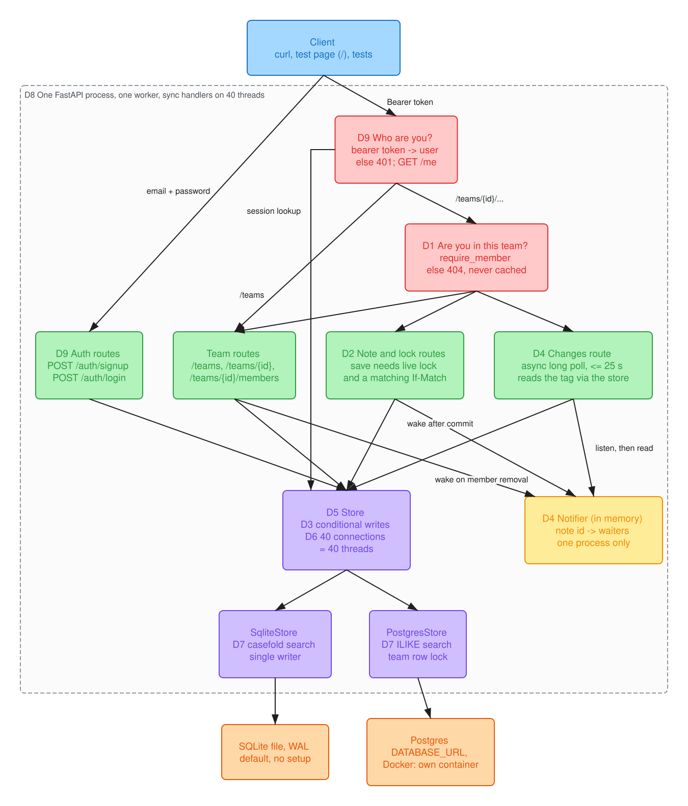
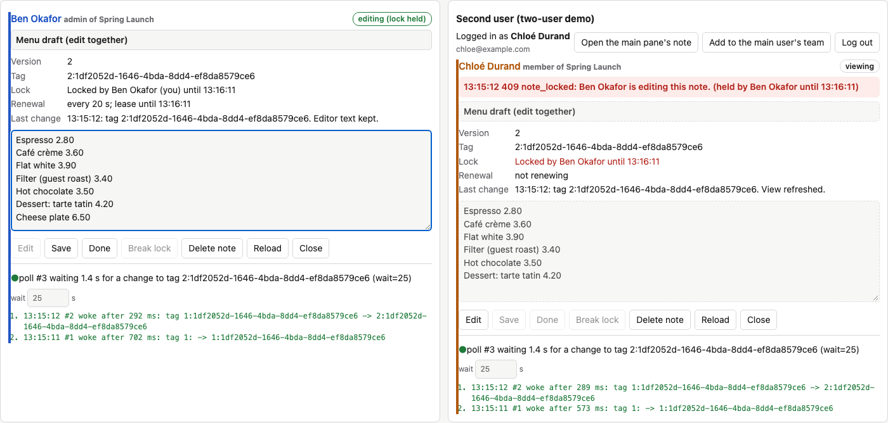

# Team Notes API

Kevin Hammer

A REST backend for notes shared within small teams: FastAPI on SQLite, or on Postgres under Docker.

## Run it

**Without Docker.** Needs only [uv](https://docs.astral.sh/uv/), which fetches Python 3.12:

```sh
scripts/run.sh
```

**With Docker.** The service and Postgres 17, in two containers:

```sh
docker compose up --build
```

Either way, open http://localhost:8765/ and log in as `ada@example.com` or `ben@example.com`, password `demo-password`. Both commands seed that demo data into an empty database and serve everything on one port:

- `/` is a test page that drives every endpoint and lists the demo logins
- `/docs` is the API explorer
- `/site/` is the docs site
- `/health` answers 200 while the process is up

If port 8765 is taken: `PORT=8766 scripts/run.sh`, or `TEAM_NOTES_PORT=8766 docker compose up --build`. Stop either with Ctrl-C; `docker compose down -v` also deletes the Docker data.

The smallest start is `uv run uvicorn app.main:app --port 8765`: the API and test page on SQLite, with no demo data and no docs site, so sign up on the test page.

## Test it

```sh
uv run pytest                                           # SQLite
TEST_DATABASE_URL=postgresql://... uv run pytest        # the same suite on Postgres
```

304 tests pass and one is skipped on each database. [How it is tested](#how-it-is-tested) says what the tests prove.

## The brief

> "You're building the backend for a note-taking service used and shared amongst several small teams. Users need somewhere to capture and work with their notes. Deliver a runnable REST service and README. We will review your code for clarity, correctness, and the tradeoffs you made. You choose the language, framework, schema, endpoints, storage, and what's in scope. Be ready to defend those choices."

The answer is a FastAPI service in Python 3.12 over one relational database, SQLite by default and Postgres in Docker. Teams own notes; every member reads every note of the team, and one member at a time edits a note while the others watch it change. The hard part is shared data that stays correct: a team's notes are invisible outside it, no accepted edit is overwritten silently, a vanished or idle editor does not block a note for long, and viewers learn within a second that a note changed. [The design walk](docs/DESIGN.md) follows the design in order; [the API contract](docs/API_CONTRACT.md) is the wire format.

[](docs/diagram/architecture.svg)

The request flow; click it for the full board. The letters on the board match the section headings below: T requirements, E entities, D1 to D9 decisions, L limits, G growth path. S is what was left out. [Diagram sources](docs/diagram/README.md).

## The design choices I spent the most time on

### 1. One editor at a time, without losing an edit

**Decided.** The edit lock is a lease. The editing page renews it every 20 s, and it lapses 60 s after the last renewal, so a closed laptop frees the note within a minute. Separately, a holder who has not typed or saved for 10 minutes loses it even while the tab keeps renewing. An admin can break it at any time. Under it sits a version check: a save or delete sends the note's version in `If-Match`, and a stale one gets 412 with the current note. Each save and delete is a single SQL statement whose `WHERE` clause holds the whole rule, so nothing can land between the check and the write ([D2](#d2-edit-lock), [D3](#d3-conditional-writes)).

**Considered.** The simpler option is the version check alone: it keeps every save correct, and the brief asks for no lock. But then the second editor learns of the conflict after typing, not before. The lock alone is not enough either: if Alice's lease lapses while her laptop sleeps and Bob saves, Alice can take the free lock again and would overwrite Bob with old text; the version check refuses that. Not chosen: a database row lock held while someone types, a lock with no expiry, a lock in Redis (it cannot commit together with the note), and editing together, which is left out.

**Why the idle rule.** A lease covers a client that has gone, not a forgotten tab that keeps renewing. The lock records the holder's last activity (a take, a successful save, a renewal with `active=true`); after 10 minutes the lock is free for everyone, and the holder's next renewal gets 409 `lock_idle`, which frees the note in the same statement and wakes viewers.

**Cost.** Three calls per edit plus renewals, a client that must track lock state (the contract's "Client protocol"), and trust: the server cannot see typing, so it believes `active`, and only an admin breaking the lock stops a client that lies. **Reopen if** people must edit one note together.

### 2. Telling viewers a note changed, without a thread or a connection per viewer

**Decided.** A viewer keeps one long poll per open note, `GET .../changes?since=<tag>`, held up to 25 s. It is the one `async` handler: a waiting poll is a paused coroutine and an entry in an in-memory table, and holds no worker thread and no database connection. A write wakes the note's waiting polls after it commits ([D4](#d4-change-notification), [D6](#d6-connections)).

**Considered.** The simpler option is plain polling. At the target of 1,000 viewers, polling every 2 s is 500 requests a second to deliver news that arrives a few times a minute, with up to 2 s delay. A conditional GET makes replies cheaper, not fewer. Server-sent events and WebSockets push at once, but check membership when the connection opens and not on every change, and some proxies buffer them. A long poll answers at once with plain requests that work from curl.

**Why the connection rule.** FastAPI runs a sync handler and each of its dependencies as separate trips to a worker thread. Each store operation opens and closes its database session inside one such trip, so the connection pool can equal the 40 worker threads. A session kept across trips would hold a connection while queuing for the next thread, and enough of those deadlock the pool.

**Cost.** Waiting polls live in one process, so the service runs one worker. The time to wake everyone grows with the number of viewers of one note, because each one re-reads the note on the shared thread pool; the 200-member cap bounds it ([measurements](docs/MEASUREMENTS.md)). **Reopen if** a second process is needed (Postgres `LISTEN`/`NOTIFY`, see Growth path) or waking a busy note takes over 1 s.

### 3. One store, two databases

**Decided.** Routers call one interface, the store. `SqlStore` writes every operation once in SQLAlchemy; SQLite and Postgres each answer four hooks: the engine, case folding for search, a lock for rules that count rows, and which errors mean "busy" ([D5](#d5-one-store-two-databases)).

**Considered.** The simpler option is SQLite only. It needs no setup and its single writer covers the target of about 5 writes a second. But with one writer every check-then-write is atomic for free, which hides the real question: do the rules survive concurrent writers? On Postgres at READ COMMITTED a rule about one row still holds, because a second writer of that row waits and re-checks the `WHERE`. A rule that counts other rows (the member cap, the note cap, the last admin) does not: two transactions each count from their own snapshot and both pass. So on Postgres those writes lock the team row (`SELECT ... FOR UPDATE`) first. SERIALIZABLE would also be correct, but the loser would get a 503 instead of the right 409.

**Why two run paths.** `uv run` needs nothing installed and uses SQLite; `docker compose up --build` uses Postgres, so the one-command path exercises the engine where the rules are hard. The suite runs on both.

**Cost.** One documented search difference and a second test run. **Reopen if** the engines need more than four hooks, or several processes are needed: keep Postgres only.

## Start here

Where each decision lives in the code, and the test that fails if it is broken.

| Decision | Code | Test that pins it |
|---|---|---|
| [D1](#d1-isolation) one membership check guards every team route | [app/deps.py](app/deps.py) `team_router`, `require_member` | [tests/test_isolation.py](tests/test_isolation.py) `test_every_team_route_is_guarded`, `test_access_matrix` |
| [D2](#d2-edit-lock) the lock: a lease with an idle rule | [app/store/sql.py](app/store/sql.py) `take_lock`; [app/models.py](app/models.py) `lock_is_live` | [tests/test_locks.py](tests/test_locks.py) `test_idle_holders_renewal_past_the_limit_is_refused_and_frees_the_note` |
| [D3](#d3-conditional-writes) each write's rule inside its one statement (the lock call: two in one transaction); the version sent as `If-Match` | [app/store/sql.py](app/store/sql.py) `save_note`, `_write_or_refuse`; [app/preconditions.py](app/preconditions.py) `expected_version` | [tests/test_locks.py](tests/test_locks.py) `test_stale_save_after_lease_lapse_is_a_version_conflict`, `test_lock_rule_is_judged_before_the_precondition`; [tests/test_races.py](tests/test_races.py) |
| [D4](#d4-change-notification) long poll without a thread or a connection | [app/routers/changes.py](app/routers/changes.py) `watch_changes`, [app/notify.py](app/notify.py) | [tests/test_changes.py](tests/test_changes.py) `test_change_between_first_read_and_wait_is_not_lost` |
| [D5](#d5-one-store-two-databases) the same rules on SQLite and Postgres | [app/store/postgres.py](app/store/postgres.py) `_lock_team` | [tests/test_races.py](tests/test_races.py) `test_admins_leaving_at_once_leave_exactly_one_admin`, run with `TEST_DATABASE_URL` |
| [D6](#d6-connections) 40 connections for 40 threads, never a deadlock | [app/store/sql.py](app/store/sql.py) `_session` | [tests/test_burst.py](tests/test_burst.py) `test_requests_far_beyond_both_pools_all_succeed` |
| [D7](#d7-search-and-paging) search scans one team; lists page by keyset cursor | [app/store/sql.py](app/store/sql.py) `notes_page`; [app/cursor.py](app/cursor.py) `decode_cursor`; `_contains_folded` in [app/store/sqlite.py](app/store/sqlite.py) and [app/store/postgres.py](app/store/postgres.py) | [tests/test_notes.py](tests/test_notes.py) `test_walk_under_concurrent_changes_never_repeats_or_skips_a_stable_note`; [tests/test_store.py](tests/test_store.py) `test_a_cursor_page_is_one_range_of_the_list_index`, `test_search_folding_on_each_database` |
| [D8](#d8-sync-handlers-on-a-thread-pool) sync handlers on 40 threads, the long poll the one async route | [app/main.py](app/main.py) `create_app` | [tests/test_burst.py](tests/test_burst.py) `test_thread_pool_and_connection_pool_are_one_number` |
| [D9](#d9-authentication) opaque tokens stored hashed; a failed login looks the same whether or not the email exists | [app/security.py](app/security.py) `verify_password`; [app/routers/auth.py](app/routers/auth.py) `login` | [tests/test_auth.py](tests/test_auth.py) `test_the_dummy_hash_has_the_production_cost` |

## Running it, in detail

The three run paths:

| Path | Command | Database | Docs site and demo data |
|---|---|---|---|
| Bare, zero setup | `uv run uvicorn app.main:app --port 8765 --timeout-graceful-shutdown 3` | SQLite `./notes.db` | neither |
| Bare, full | `scripts/run.sh` | SQLite `./notes.db` | both |
| Docker | `docker compose up --build` | Postgres 17 in its own container | both |

Docker runs two containers from that one command: `db`, the official `postgres:17` image, reachable only on the compose network; and `app`, a slim image of the service alone, which starts once `db` is healthy and uses `GET /health` as its own health check.

The demo data is seeded only into a database with no accounts, so start `scripts/run.sh` or Docker on a fresh `notes.db` or volume. The other demo logins and things to try are in [the seed data](docs/SEED_DATA.md). Run one worker process, because waiting polls are held in its memory.

Settings, backups and the image are in [running it](docs/RUNNING.md); the same flows from the command line are in [the curl walkthrough](docs/WALKTHROUGH.md). The test page's "Two-user demo" switch signs a second user into a second pane:



## How it is tested

The same suite runs on SQLite and, with `TEST_DATABASE_URL`, on Postgres, with a schema per test. 305 tests are collected; 304 pass and one is skipped on each database, because it inspects the other database's internals. Each test gets a fresh app and database, nothing in the database layer is mocked, and a replaceable clock drives lease, idle and token expiry. Races use real concurrent requests.

A test only proves a rule if it fails when the rule is removed. The concurrency tests in `test_races.py` are checked that way on both databases: the rule is moved out of its statement, or the team row lock is removed, and the test must fail. One of them, the race between an idle release and another take, is not checked, and its docstring says so. The route check in `test_isolation.py`, the connection rule in `test_burst.py` and the shutdown test in `test_changes.py` are checked the same way; other tests are not. [The tests overview](tests/README.md) maps each claim to its test and has a recipe for a throwaway Postgres.

## Requirements

### Functional (F)

Users should be able to:

1. sign up and log in.
2. create a team, and team admins should be able to add and remove its members.
3. create notes in their teams, and read and delete any note of their teams.
4. edit any note of their teams, one editor at a time, while teammates keep reading it.
5. Users viewing a note should be able to see that it is being edited and be told when to reload it.
6. list a team's notes, most recently edited first, and search them by text.
7. Team admins should be able to release a note that another member is holding.

Below the line: edit the same note at the same time; share a note outside its team, or keep one private; restore a deleted note or an earlier version; add attachments or rich text; invite by email, change roles, rename or delete a team; log out, reset a password or use single sign-on; a service administrator who can see or manage every team (an exception to team isolation, so it needs its own access path and an audit log).

### Non-functional (T)

The system should:

1. be secure across teams: no request reads or changes data outside the caller's teams, and an outsider cannot tell whether a team or note exists (D1, D9).
2. prioritise consistency over availability for edits and membership: an accepted save is never silently overwritten, and a removed member loses access on their next request (D1, D2, D3).
3. recover a note from an editor who has gone: within 60 s if they disappeared, and within 10 minutes if their tab is open but untouched (D2).
4. have low-latency change notification: a viewer is told within 1 s that a note was saved, locked or unlocked (D4). Met at the target team size; not reliably at ten times it ([Measurements](#measurements)).
5. have low-latency list and search: under 200 ms at 10,000 notes per team (D7). Met on both databases; search on Postgres has the least margin ([Measurements](#measurements)).
6. be able to serve about 20 teams of up to 50 people from one process, including every member waiting on a note at once (D4, D6, D8).
7. run from one command with nothing installed but uv, and run the same on Postgres in a container (D5).

Below the line: high availability and fault tolerance (one process, one database); compliance, audit logging and encryption at rest; rate limiting and login throttling; more than one region or instance.

**Consistency and availability.** With a single database there is no network partition to tolerate, so the CAP choice shows in what the service does when the database is slow or unreachable, and in which reads could lag if it grew. Edits, the lock and membership choose consistency: they are always read and written against the one database and never served from a stale copy. A database busy past the 5 s wait answers 503 `busy` with `Retry-After: 1`, nothing written; an unreachable one fails the request (500). Two lock holders, or a removed member still reading, is worse than a refusal. Viewer notification leans toward availability: it is eventual, held in memory and self-healing, since a viewer who misses a wake-up catches up on the next poll. Lists and search are the reads that may lag, which is what lets them move to replicas later while edits and membership stay on the primary.

## Entities (E)

```
users        id, email UNIQUE, name, password_hash (argon2), created_at
sessions     token_hash PK (SHA-256 of the bearer token), user_id, expires_at
teams        id, name, created_at
memberships  (team_id, user_id) PK, role 'admin' | 'member', created_at; index (user_id)
notes        id, team_id, author_id, title, body, version, lock_user_id, lock_expires_at,
             lock_active_at, created_at, updated_at; index (team_id, updated_at DESC, id DESC)
```

IDs are random UUIDs, so they cannot be guessed or counted. The edit lock is three columns on the note (holder, lease end, last activity), set or cleared together under a check constraint, so one statement can test "I hold a live lock" and "my version is current" together. A note's **tag** is its version plus its live lock holder; it changes on save, lock and unlock, and a viewer waits on it. Constraints and the index behind each endpoint: [the design walk](docs/DESIGN.md).

## Decisions

Each gives the choice, what was not chosen and why, the cost, and what would reopen it.

### D1. Isolation

Every router for `/teams/{team_id}/...` is built by `deps.team_router()`, which attaches `require_member` to the whole router. It reads the membership by primary key on every request, never cached, so a removed member is refused at once; the cost is that read. Outsiders get 404, not 403, so IDs cannot be probed. Every note statement also filters on `team_id`. A route added any other way fails `test_every_team_route_is_guarded`, which walks the served routes. Identity comes only from the token.

Not chosen: a check in each handler (one forgotten call leaks a team), or Postgres row-level security (it would not cover SQLite). Per-note access lists are a different model and are left out. Reopen when private notes or sharing come into scope.

### D2. Edit lock

The argument is [design choice 1](#1-one-editor-at-a-time-without-losing-an-edit). `PUT .../lock` takes a free, expired or idle lock, or renews the caller's own; `PUT .../lock?renew=true&active=...` only renews, never re-takes a lost lock, and requires `active` so a client that does not know the idle rule fails loudly. A lock is live while its lease runs and its holder's last activity (`lock_active_at`) is under 10 minutes old; one condition, `lock_is_live`, is used by every statement and read, so an idle lock is free for everyone at the same instant.

- **60 s** lease: rides out a short network drop; a teammate waits a minute, not until the laptop reopens.
- **20 s** renewal: a third of the lease, so one missed renewal is harmless.
- **10 minutes** idle: about a meeting's absence, so a forgotten tab does not hold a note all afternoon.

Not chosen: idleness judged by the server alone, because renewals arrive whether or not anyone is typing.

### D3. Conditional writes

Every write has a rule it must pass: the caller holds a live lock, the version is current, the team is under its cap, an admin remains. Each such write is one statement whose `WHERE` clause holds the whole rule. (The lock call is the exception: a renewal attempt, then the take or the idle release, in one transaction, so the caller learns which happened.) The number of rows changed is the decision; only when it is zero is the note read, to word the error (`_write_or_refuse`). Duplicates are left to `UNIQUE` and primary keys. The full list, and why each is atomic on each database: the [app/store/sql.py](app/store/sql.py) docstring.

The version travels as an HTTP precondition: every single-note response carries `ETag: "<version>"`, and a save or delete must send it in `If-Match`. Missing: 428 `precondition_required`. Malformed, stale, weak, a list, or `*`: 412 `precondition_failed` with the current note. Checks answer in this order: authentication, team access, the lock rule (and authorship for a delete), then the precondition; the comparison itself is inside the write's statement.

Not chosen: read, check, then write, which leaves a gap between the check and the write (the concurrency tests fail when a rule is rewritten that way); the version in the JSON body (a private convention where HTTP has a standard one). Reopen if a rule needs rows its statement cannot see: then SERIALIZABLE with retries, or a parent-row lock as D5 uses.

### D4. Change notification

The argument is [design choice 2](#2-telling-viewers-a-note-changed-without-a-thread-or-a-connection-per-viewer). A poll registers itself as waiting, then reads the note's tag, then waits, so a save between the read and the wait still wakes it. Writes call `wake(note_id)` after commit. A wait is capped at the lock's remaining lease, since an expiring lease writes nothing; 25 s stays under common proxy idle timeouts. Every poll re-checks membership before it answers. Costs: one process (the growth path adds Postgres `LISTEN`/`NOTIFY`); a lock passing the idle limit writes nothing, so viewers hear of it at the holder's next renewal, the lease's end or the poll's end; a crash between commit and wake loses that wake, and the next poll catches it.

### D5. One store, two databases

Routers call one interface, the **store** ([app/store/interface.py](app/store/interface.py)). `DATABASE_URL` picks the implementation.

| Hook | SQLite (default) | Postgres |
|---|---|---|
| Rules that count rows | nothing: the count runs under SQLite's single write lock | `SELECT ... FOR UPDATE` on the team row first (READ COMMITTED) |
| Search folding | Python `str.casefold`: `strasse` finds `Straße` | `ILIKE`, per character: it does not |
| Busy, to 503 `busy` | "database is locked" after 5 s | lock timeout after 5 s, deadlock, serialization failure |
| Engine | WAL, `synchronous=FULL` | `pool_pre_ping`, `lock_timeout` |

Single-row writes need no hook. The argument, alternatives and cost are [design choice 3](#3-one-store-two-databases).

### D6. Connections

Each store operation opens and closes its own session inside one trip to a worker thread, so no request holds a connection while it waits for a thread, at most one connection is in use per busy thread, and the pool is capped at the 40 threads with no overflow. A session held across trips, or a pool smaller than the thread count, can deadlock. Full reasoning: the [app/store/sql.py](app/store/sql.py) docstring. Cost: no transaction spans two store operations. Reopen if a code path ever needs two sessions at once.

### D7. Search and paging

`q` is a case-insensitive substring match on title and body within one team, `%` and `_` literal. No index serves it: it scans the team's notes, bounded by the 10,000-note cap. Unicode folding costs scan time and is worth it: SQLite's `lower()` folds ASCII only, so `café` would not find `CAFÉ`, a wrong answer rather than a slow one. Against the 200 ms target: [measurements](docs/MEASUREMENTS.md). Next step: FTS5 or `tsvector` in the same database. Reopen on a search time over the target or a higher note cap.

**Paging is by cursor** (keyset paging), ordered by `updated_at DESC, id DESC`. The cursor is the position of the last row returned; the next page starts strictly after it, as one range of the index `(team_id, updated_at DESC, id DESC)` on both engines, so a deep page costs what the first does. Offset paging was not chosen: it reads and discards every earlier row, and a note created, edited or deleted between pages shifts the rest, so a walk could repeat or skip notes. Paging by cursor never repeats a note and never skips one unchanged for the whole walk; a note edited during it moves to the front and is not shown again. The cursor grants nothing: every page runs the team check. Cost: no jump to page N, no total count.

### D8. Sync handlers on a thread pool

Python 3.12 and FastAPI: typed models give validation, the error shape and an OpenAPI explorer with little code. Every handler is sync code on 40 threads except the long poll. Sync drivers and SQLAlchemy sessions are plain to write and test, argon2 blocks a thread anyway, and only the long poll waits long. Not chosen: async throughout, which removes the trips between threads and the 40-thread ceiling, but turns every store call async, still runs aiosqlite and argon2 on threads, and would mean rewriting the threaded concurrency tests. Cost: the trips between threads create D6's deadlock risk, and threads add no CPU parallelism. Reopen: if requests queue for threads while the CPU idles, make the store async; if the CPU is the limit, add processes (see Growth path).

### D9. Authentication

An opaque random token whose SHA-256 is stored in `sessions`, valid 7 days, looked up by primary key. Passwords use argon2; an unknown email is checked against a dummy hash of the same cost, so a failed login gives the same answer in about the same time either way. A JWT would save the lookup but needs key management and cannot be revoked early. Reopen if authentication moves to a separate service.

### Smaller decisions

- **SQLAlchemy, not raw SQL**: one layer for both dialects. The two `INSERT ... SELECT` writes that enforce a cap read their outcome with `RETURNING`, because psycopg reports an unknown row count for them.
- **The app's clock, not the database's**: one source, replaceable in tests; a write that waited for the busy timeout is judged up to 5 s late. Use the database's `now()` with several processes.
- **Two containers**: Postgres and the app restart, upgrade and back up separately, and the app image runs against any Postgres.
- **No availability target**: one process; a restart ends held polls with 204 and loses nothing committed.

## Measurements

Taken with the scripts in `scripts/measure/`, in a Linux container on an Apple-silicon Mac (10 CPUs visible to the container, other work running on the host), on 2 teams of 10,000 notes. Ranges are minimum to maximum with the median in brackets. Conditions, run counts and the rest: [measurements](docs/MEASUREMENTS.md).

| Measure | SQLite | Postgres 17 |
|---|---|---|
| List page 1, warm | 3.1 to 4.6 ms (3.2) | 3.2 to 3.5 ms (3.3) |
| Deep page by cursor, warm | 3.2 to 4.3 ms (3.9) | 3.4 to 3.6 ms (3.6) |
| Search of 10,000 notes, warm | 69.2 to 75.2 ms (70.1) | 172 to 173 ms (172) |
| Search of 10,000 notes, cold | 97 to 102 ms (101) | not measurable |
| Get one note, warm | 1.9 to 3.2 ms (2.8) | 2.5 to 2.8 ms (2.5) |
| Saves per second at 1, 32 and 128 savers | 344 to 345, 441 to 454, 409 to 434; none refused | 275, 339, 342 (one run); none refused |
| Authenticated reads per second at 1 and 40 clients | 616 to 660 (634), 597 to 602 (598) | not run |
| 50 polls held on one note (the target team): median wake, slowest wake | 60.6 to 70.2 ms (67.1), 66.8 to 75.4 ms (70.1) | not run |
| 500 polls held on one note, two sessions: median wake, slowest wake | 383 to 1,083 ms, 587 to 1,386 ms | not run |

Against the requirements: list pages and single reads are far under 200 ms on both engines, and a deep page costs what the first does (D7). Search meets 200 ms on both: about 70 ms warm and about 100 ms cold on SQLite, and about 172 ms warm on Postgres, which leaves little margin there and is why full-text search in the database is the next step (D7). Writes run at 275 to 454 saves a second against a need of about 5. A viewer is told well within 1 s at the target team's 50 viewers. At 500 polls on one note, ten times that, the two sessions differ with the host's load and the slowest poll wakes in up to 1.4 s, so the requirement is not reliably met at that size. The fix is the growth path's second row: one shared read per change instead of one per viewer.

## Limits (L)

Product limits bound every query but the team list (below). Exact rules: the contract's "Limits".

- Title 1 to 200 characters, body up to 100,000, request body 1 MB.
- 200 members per team: four times the target team, bounding the unpaged member list and the number of viewers one change wakes. 10,000 notes per team: the target, bounding the search scan.
- Page size 1 to 100, `cursor` up to 200 characters, `q` up to 200.
- Lock lease 60 s, renewed every 20 s, idle limit 10 minutes; a long poll waits up to 25 s; 10 held polls per user.
- Tokens last 7 days; there is no logout.
- A write waits up to 5 s for another writer, then 503 `busy`, safe to retry.
- One process only, because waiting viewers are held in its memory.
- `/health` reports the process only, not the database.
- A user's teams are not capped and `GET /teams` is not paged: it is the one list a caller can grow without bound.
- Sign-up (409 `email_taken`) and adding a member (404 `user_not_found`) reveal whether an email is registered; only login hides it (D9).
- `/docs` and `/redoc` load their scripts from a CDN, unpinned.
- The idle rule trusts the client's `active` flag; only an admin break bounds a client that always sends `true`.
- Typing is reported at the next renewal, up to 20 s later, so typing that starts in the last 20 s before the idle limit can still lose the lock (409 `lock_idle`); the draft is kept and the lock can be taken again.
- A Postgres server set to a non-UTC time zone is untested; times are stored as UTC in `timestamp without time zone`.

## What I'd change, add, or stop doing with more time

**Change**

- Map a database connection failure to 503 with `Retry-After`, as a busy database is; today it is a 500.
- Renew at once on the first keystroke after a quiet spell, not at the next 20 s tick, so typing just before the idle limit keeps the lock.
- Use the database's clock for leases and the idle limit, so a write is judged when it runs, not when it arrived.
- Make the store async if requests ever queue for threads while the CPU idles (D8).

**Add**

- A readiness check that also pings the database, for a load balancer; `/health` stays the liveness check.
- Blob storage for bodies, if the 100,000-character cap is too small or attachments arrive. The save writes the new body to the blob store under a new unique key that nothing points to yet, then runs today's conditional update with one more column, pointing the row at the new key where the lock and version match. A refused or crashed save leaves only an orphan blob, which a cleanup job deletes after a grace period. The database update is the single commit point, so no saga is needed: the first step is invisible until the second commits, and there is nothing to compensate. Costs: a second store, a cleanup job, a read that makes two fetches or hands the client a signed URL, and a search that cannot scan the body in the database.
- A search service behind a small interface (index a note, remove a note, search a team for ids), designed as a derived store: fed from the notes database, with a stated lag, a rebuild path, a defined answer when it is down, and every result re-read from the notes database under the caller's membership, so a stale index never shows a note the caller may not read. The first step is full-text search inside the same database (FTS5, `tsvector`), where the index cannot drift. Trigger: a measured search time over the target, or a higher note cap.
- A cap on the teams one user can create or join, and paging for `GET /teams`, the one unbounded list.
- Email verification at sign-up and invitations by email, so that neither sign-up nor adding a member reveals whether an address is registered.
- A super admin who can manage every team and user: list all teams, add or remove any member, disable an account. It is a deliberate exception to team isolation, so it needs its own access path, its own tests and an audit log of every use.
- Trash and history (delete is permanent), idempotency keys for creates, schema migrations, metrics and structured logs, logout and login throttling.

**Stop doing**

- The docs site and the measurement scripts: more packaging than a service this size needs. The README, the contract and the tests carry the argument.

## Growth path (G)

Not built. In order, with the trigger for each.

| Trigger | Step | New trade-off |
|---|---|---|
| More than one app process | Postgres, a load balancer, `LISTEN`/`NOTIFY` feeding each notifier (D4), the database clock | the notifier is the only in-process state |
| Wake time over 1 s | one note read and one batched membership read per change, shared by every poll waiting on that note | a more complex wake-up |
| Search over 200 ms, or ranking | FTS5 or `tsvector` in the same database (D7) | larger index, slower writes |
| Reads outgrow one machine | read replicas for list and search (the requirements let them lag) | a user's reads go to the primary for a few seconds after a write |
| A measured hot read | a cache with explicit key and expiry | staleness; never cache membership |
| Data outgrows one database | shard by `team_id` | `GET /teams` is a query by user across shards, so it needs a user-to-teams table outside them; routing a team to its shard needs none with consistent hashing |

## How this was built

I set the requirements, the scope and the decisions. AI coding agents (Claude) wrote the code, tests, test page and docs to them; the exercise's instructions encourage AI tools. Independent review agents attacked the running service on both databases with their own scripts, and the concurrency tests are checked to fail when the rule they protect is removed.
