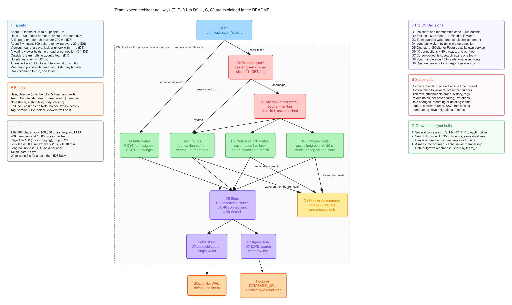

# Architecture diagram

The full board: the request flow in the middle, with targets (T), entities (E), limits (L), decisions (D1 to D9), scope cuts (S) and the growth path (G) around it. Each key is a heading on the [home page](../README.md), which gives the reasons. Click the board to open it alone, then zoom with the browser: [the full board as SVG](diagram/architecture.svg).

Sources and the regenerate command: [diagram sources](diagram/README.md). Editable board: `diagram/architecture.excalidraw`.
